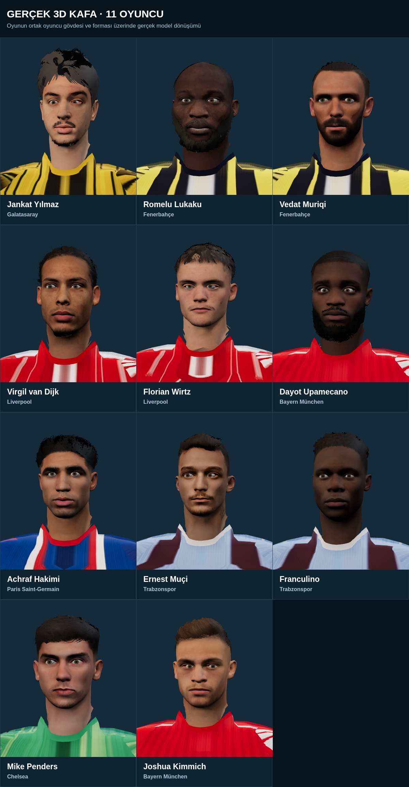
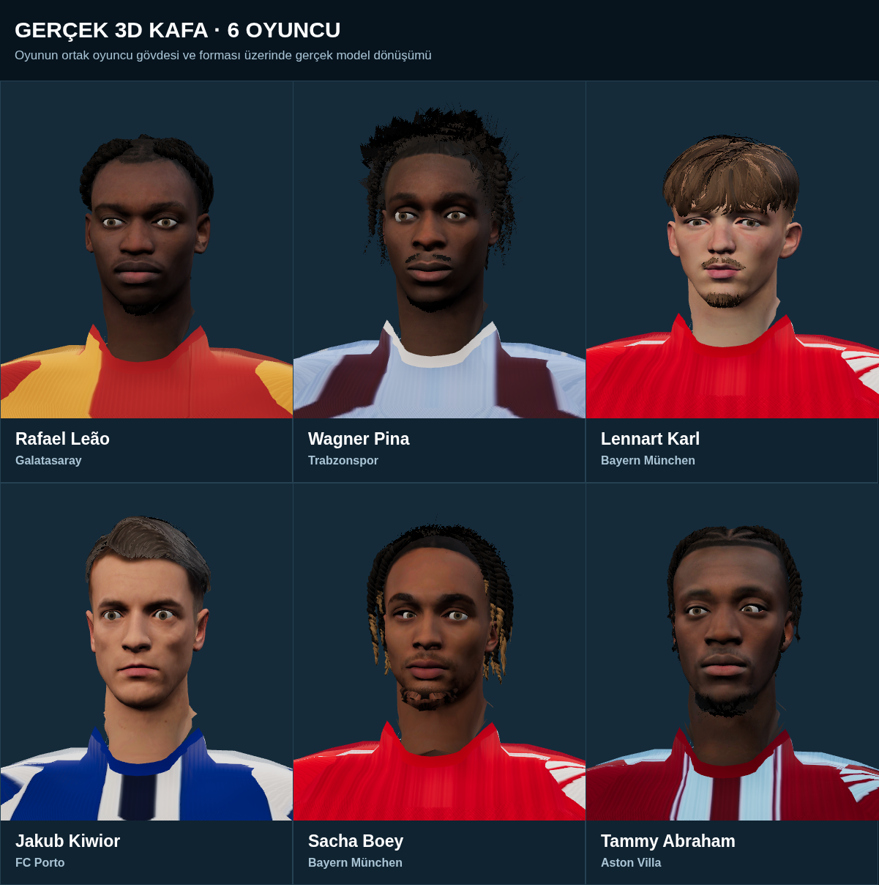

# V245 / T-400 — selected FM27 real-head expansion

**Accepted runtime:885 heads =332 preserved +553 additions.** Additional158,229,912bytes;
total347,035,642bytes. New model max575,375bytes /33,815triangles. Only selected
identities load during a match; source8.9GB ZIP/RFH/plugin/game files are not deployed.
accepted-report.json is the final acceptance list/count; earlier attempt reports
record source candidates, including later visual rejections.

Sources/reproduction: [import tools](../../../../tools/head-import/README.md),
fm27-sources.json and fm27-plan.json. CSV SHA256:
aec39104895990d07ceb7e2e072a6f83ee4d104e1e9e74bf36aecb4a8b0d2c9d.
Base archives followed by v1.0.2 and v1.1.1 patches; current CSV excludes managers and
removed wrong matches. Unique source name + reviewed same-club alias binds the
existing game ID and DOB. Source CSV has no DOB; do not claim independent source
birth-date data. Ambiguous/different-club candidates stay deferred, not another
person's replacement head. Existing332asset bytes/hashes and identities stay intact
(preservation-report.json). No roster/forecast/seed/score changes.

## Acceptance and remaining sources

556 planned:553 accepted new,1 Slonina identity joined to his existing head,
Fábio Silva rejected by the35k-triangle/appearance budget, Castello Lukeba rejected
by visual review. Initial source-attempt-report records8dense rejections; seven
were subsequently hair-simplified, then Lukeba's visible polygonal hair cards
failed close-up review (threshold/UV trials did not help). He is explicitly
disabled in the import plan and his own portrait remains. The final six simplified
models keep card borders/normal/UV weights with <=1% relative error; original face
vertices differ only by <0.016mm quantisation (face-preservation-report). Meshoptimizer
1.3.0 MIT is an offline tool, never loaded/distributed as a game dependency. Face1024/
hair512textures remain. Dummy three-vertex hair shells are omitted.

Batrakov is **not in the author's currentCSV**. Separate public sources:
- https://pes-files.ru/aleksei_bartakov_face (Obsessed Artist) links
  https://modsfire.com/Wzbdv46yewcHIfp (A.Batrakov.rar,7.53MB). Ordinary public link
  steps worked; final anonymous request returned403/HTML, including cookie retry.
- https://pes-files.com/pes-2021-aleksey-batrakov-face/ (Valerchi7) links
  https://sharemods.com/2sixo133kh3m/A._BATRAKOV.rar.html (earlier CAPTCHA).
No model acquired/no bypass. Keep his verified portrait until an accessible source
passes identity, geometry and close-up checks. Other unselected CSV identities need
club/bio review and a future size budget, not an automatic bulk import.

## Actual renderer images

These are current shared actors with real source geometry, existing game kits/body,
neck and skin fit. No generated artwork or stand-in shirts. Portable eyes replace
FM's external eyeball dependency; no FM facial skeleton/animation was imported.

[Open11player close-ups](closeups.png) · [Open6accepted dense-source close-ups](dense-closeups.png)

## Validation and limits

-77/77 full Node/PHP suite PASS (suite-report). This started with879heads; final
  asset/cache refinements were followed by targeted885geometry/hash/identity,
 153neck/body/kit/skin/rewind poses, catalogue revalidation checks (body-fit,
  coverage, head-runtime reports). RFH/range parser6/6 PASS (format-report).
-8production modes PASS:five,Japon,penalty,freekick,futnet1,bowling,eleven,competition;
  four samples including rewind, final camera matrix, fixed buffers/actor details,
  no shader/head/kit failures (modes-report). First4had879catalogue entries; later
  modes886. Final5/mobile checks used886, then non-participant Lukeba was removed;
  final6close-up pilot used885. Do not label these as exhaustive885-player renders
  in every camera mode.
- Final desktop5and iPhone-UA/LITE-profile5 PASS, with mobile face texture cap512;
  software Chromium, not physical Safari/device. Final6head pilot PASS. Source
  bounds checked for all553new models. Shared V244 temporal fixes stay in place.
- V244 controlled moving-turf comparison and short1080p60MP4 fixture are separate
  in research/temporal-v244. No new full-match video or physical-device claim.

coverage.json / face-coverage.html distinguish actual3D vs own photograph vs generic
for every current squad.153/180club squads and56national squads have at least one
matching model; this is not complete player coverage. GS24real+5photo;FB21+4;
BJK23+4;TS20+7+2generic;Liverpool23/23real. T-400 source gaps remain partial.
Aylık / Headers and Volleys stays paused by user instruction.
