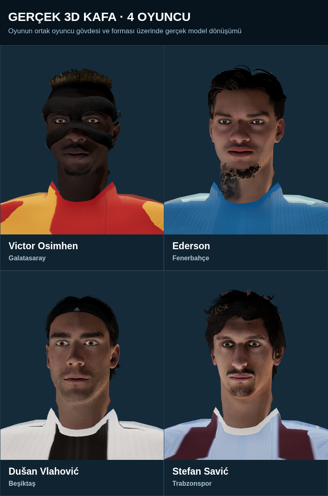
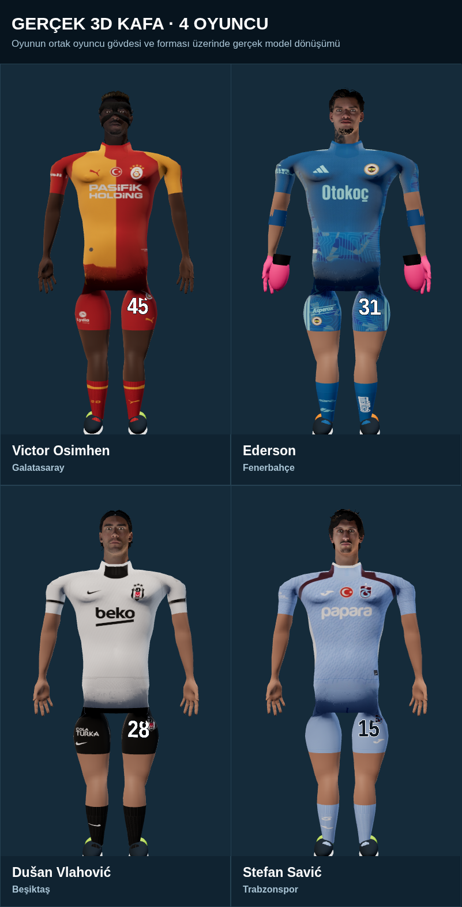

# V243 gerçek kafalar ve sahne kalitesi

Gerçek ortak Scene aktörleri ve mevcut takım/kaleci formaları; yapay üretilmiş görsel değil.





Gerçek MP4 çıktısından Yunus Akgün: [oyun içi kare](bowling-real-head-frame.png).

332kimlikli model /188,805,730byte. Bütün kadroların gerçek3Dmodeli tamamlanmış değildir: coverage.json ve face-coverage.html gerçek model/kendi fotoğrafı/genel ayrımını verir. Büyük takım ilk11+yedekleri birlikte sayılır. İsim benzerliğiyle farklı futbolcuya kafa verilmez.

- final-checks.json:332modelin GLB sınırları/sonlu koordinatları;4modelde36boyun/baş/bel pozu, forma/ten/geri sarma, geç yüklenen gövde.
- closeup-report.json / fullbody-report.json / diversity-report.json: gerçek mevcut aktör/forma ile renderer görüntüsü,12farklı kimlik pilotu.
- portrait-fallback.json:30doğrulanmış kendi portresi×12poz=360fallback pozu.
- modes-report.json:7üretim modu kafa/forma/GLSL hata kontrolü, oranlar ve geri sarma.
- mobile-profile-report.json: Chromium üzerinde iPhone UA + açık lite profili, baş dokuları en çok512; fiziksel Safari/telefon testi değildir.
- video-pin-report.json: gerçek üretim UI/VideoCore ile1080×1920@60H264+AAC kısa labut kesiti.
- video-real-head-report.json: gerçek Yunus Akgün source126218aktif vuruşu1.25sn/75kare hareketli kafa kesiti; ffprobe + tamdecode.
- stable-quality-report.json: ilk/orta/son/geri sarma sırasında sabit çizim buffer'ı, aktif53kemik gövdesi ve forma yazı çözünürlüğü. Tribün/saha dışı LOD ve mobil güvenli ayarlar korunur.
- suite.json: son tam Node/PHP paketinin ham sonucu. Kısa browser/MP4 testleri bütün maç süresi ihracı veya fiziksel telefon performansı iddiası değildir.
- cleanup.json / ../ARCHIVED-MEDIA.md: hiçbir aktif kod/test/tool referansı olmayan39tarihî medya59,966,567byte; eski commit URL+SHA ile geri erişim. JS ile aynı63,031kaydı tutan8,407,697byteJSON tekilleştirildi. Ham kaynak arşiv/GLB ve yeni test MP4 sürüme eklenmez.

Mevcut ortak futbol klipleri kullanılır; yeni Mixamo/Quaternius locomotion paketinin entegre edildiği iddia edilmez. Kaynaklar/lisanslar ASSET-LICENSES.md ve tools/head-import/README.md içindedir. Kamuya açık Git geçmişi yeniden yazılmaz; temizlik HEAD ve dağıtım ZIP'ini etkiler, yeni kafalar toplam veri boyutunu artırır.

Son kalite denetimi:8mod (5v5,Japon,penaltı,FK,ayak tenisi,bowling,11v11,turnuva)×4zaman. İlk otomasyon turu bowlingde gizli ayak tenisi alanını seçmeye çalıştığı için durdu; tamamlanan5modda sayfa hatası yoktu. Seçici düzeltildi, kalan2mod ayrı PASS. İlk denemenin ham raporu quality-initial-attempt.json olarak dürüstçe korunur; birleşik doğrulama stable-quality-report.json içindedir.

11v11 başlangıç/orta/son36karelik hareketli1080p60 kesitinde bu başsız yazılımsal WebGL ortamının yerel kodlayıcısı zaman aşımına uğradı. Mevcut software-worker ile aynı gerçek hareketli kesit tamamlandı, ffmpeg tamdecode PASS (quality-video-report.json). Bu, fiziksel donanım veya bütün maç süresi performans garantisi değildir. Yeni test MP4'leri/ek4MBsahnePNG'leri repoya eklenmedi.

Yeniden çalıştırma:
```sh
NEXT90_HEAD_AUDIT=1 NEXT90_PITCH_MODES=five,japon,penalty,freekick,futnet1,bowling,eleven,competition node tests/browser-pitch-colour.cjs
NEXT90_HEAD_AUDIT=1 NEXT90_PITCH_MODES=eleven NEXT90_PITCH_EXPORT=1 NEXT90_PITCH_SOFTWARE=1 node tests/browser-pitch-colour.cjs
```
